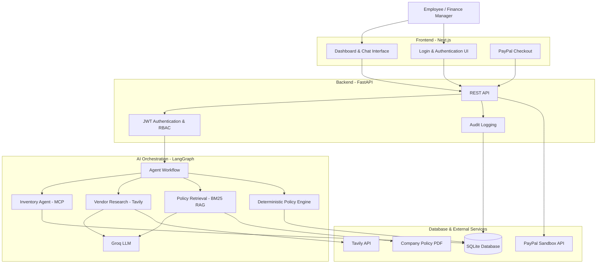
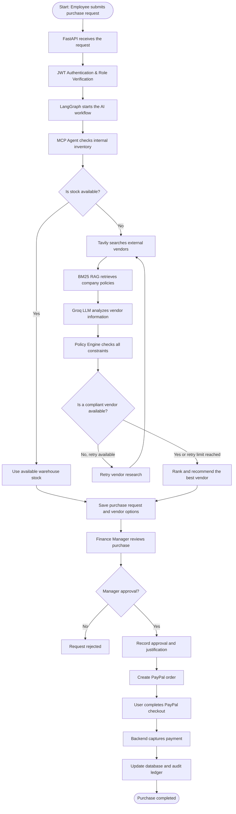

# 🤖 AgentProcure AI

### Autonomous AI-Powered Enterprise Procurement Platform

**AgentProcure AI** is an intelligent B2B procurement platform that automates the purchasing process using AI agents. It checks internal inventory, searches external vendors, verifies company policies, compares prices, and manages approvals and payments.

Built using **LangGraph, FastAPI, Next.js, MCP, RAG, Groq, and PayPal**.

---

## 📌 1. What is AgentProcure AI?

In traditional companies, purchasing products often involves several manual steps:

- Employees manually search for products and vendors.
- Companies sometimes purchase items that are already available in their warehouses.
- Employees may select vendors that violate company policies.
- Managers manually review purchase requests.
- Payment processing and transaction tracking take additional time.

**AgentProcure AI automates this entire workflow.**

An employee simply describes what they need in natural language.

For example:

> "I need 3 Dell 4K monitors for the engineering team within a budget of $1,500."

The AI system then:

1. Checks whether the products are already available in company inventory.
2. Searches external vendors if additional products are required.
3. Reads company procurement policies using RAG.
4. Evaluates vendor prices, ratings, and delivery times.
5. Recommends the best compliant option.
6. Requests manager approval when necessary.
7. Processes payment through PayPal Sandbox.

---

## ✨ 2. Key Features

| Feature | Description |
|---|---|
| 🤖 Multi-Agent AI | Uses LangGraph to coordinate different AI agents. |
| 📦 Inventory Verification | Uses MCP to check internal warehouse stock before purchasing. |
| 🔎 Live Vendor Search | Uses Tavily to discover external products and vendors. |
| 📚 Policy RAG | Retrieves relevant rules from company policy PDFs. |
| ⚖️ Policy Engine | Checks budget, delivery time, and vendor ratings. |
| 📊 Vendor Ranking | Ranks vendors using a weighted scoring algorithm. |
| 🔐 Authentication | JWT-based authentication with Employee and Finance Manager roles. |
| 👨‍💼 Manager Approval | Allows managers to approve purchases and override policy violations with justification. |
| 💳 PayPal Integration | Supports sandbox order creation and payment capture. |
| 📝 Audit Logging | Records purchase requests, approvals, and payment activities. |
| 🧠 Conversational Memory | Maintains short-term conversation context and historical purchase information. |

---

## 🏗️ 3. System Architecture

AgentProcure AI consists of four major layers:

1. **Frontend:** Provides the interface for employees and finance managers.
2. **Backend:** Handles authentication, APIs, business logic, and database operations.
3. **AI Agent Layer:** Performs inventory checks, vendor research, policy retrieval, and decision-making.
4. **External Services & Database:** Stores application data and connects to external APIs.

### High-Level Architecture



---

## 🔄 4. How Does the System Work?

The entire procurement process follows these steps.

### Complete Procurement Workflow



### Explanation of Each Stage

**Stage 1: Purchase Request**

Employees submit their requirements through the dashboard using natural language.

**Stage 2: Inventory Verification (MCP)**

The inventory agent checks internal warehouse records through a Model Context Protocol tool.

This prevents unnecessary purchases when products are already available.

**Stage 3: Vendor Research**

If additional products are needed, the research agent uses Tavily to discover external vendors, prices, product details, and delivery information.

**Stage 4: Policy Verification (RAG)**

The RAG module retrieves relevant company rules from `company_policy.pdf` using BM25 retrieval.

These rules provide context for the AI analysis.

**Stage 5: Vendor Evaluation**

Groq analyzes the retrieved information and structures vendor details.

A deterministic Python policy engine then checks whether each vendor satisfies company requirements.

**Stage 6: Recommendation**

Vendors are ranked according to price, reputation, and delivery speed.

If no compliant option is found, LangGraph can trigger another research attempt.

**Stage 7: Manager Approval**

The finance manager reviews the recommendation. Non-compliant options require an explicit override justification.

**Stage 8: Payment Processing**

After approval, the system creates a PayPal order, processes checkout, and captures the payment through the backend.

**Stage 9: Audit & History**

The database stores purchase information, approvals, payment status, and audit events.

---

## 🧠 5. AI Agent Workflow

The project uses **LangGraph** to coordinate different tasks through a shared state.

| Agent / Component | Responsibility |
|---|---|
| Inventory Agent | Checks internal stock using MCP. |
| Research Agent | Searches external vendors using Tavily. |
| Policy RAG | Retrieves relevant company rules from PDF documents. |
| LLM Analysis | Uses Groq to analyze and structure vendor information. |
| Policy Engine | Performs deterministic compliance checks. |
| Recommendation Logic | Selects the highest-scoring compliant vendor. |

### Why LangGraph?

LangGraph allows the system to:

- Coordinate multiple AI tasks.
- Maintain shared workflow state.
- Support conditional routing.
- Implement retry loops.
- Maintain conversational context.
- Control the execution flow.

---

## 🛠️ 6. Technologies Used

| Category | Technology | Purpose |
|---|---|---|
| Frontend | Next.js 16, React 19 | User interface and dashboard |
| Styling | Tailwind CSS v4 | Responsive UI and styling |
| Backend | FastAPI, Uvicorn | REST API and backend services |
| AI Orchestration | LangGraph | Multi-agent workflow |
| LLM | Groq (GPT-OSS-120B) | AI reasoning and structured analysis |
| Tool Integration | FastMCP | Internal inventory access |
| RAG | PyPDF, BM25, rank_bm25 | Company policy retrieval |
| Web Search | Tavily | External vendor research |
| Database | SQLite, SQLModel | Data persistence |
| Authentication | PyJWT | JWT authentication and RBAC |
| Payments | PayPal REST API v2 | Sandbox payment processing |
| Monitoring | LangSmith | AI workflow tracing |
| Icons | Lucide React | UI icons |
| Animations | Framer Motion | UI animations |

---

## 📂 7. Project Structure

```text
agentprocure-ai/
│
├── README.md
├── .gitignore
│
├── backend/
│   ├── main.py                 # FastAPI application and API routes
│   ├── graph.py                # LangGraph workflow and agent nodes
│   ├── schemas.py              # Request and response models
│   ├── database.py             # Database models and configuration
│   ├── inventory_mcp.py        # MCP inventory server
│   ├── rag_policy.py           # PDF processing and BM25 retrieval
│   ├── policy.py               # Compliance rules and scoring
│   ├── search.py                # Tavily search integration
│   ├── paypal_service.py       # PayPal payment operations
│   ├── company_policy.pdf      # Company procurement handbook
│   ├── requirements.txt
│   └── .env                    # Backend credentials
│
└── frontend/
    ├── package.json
    ├── package-lock.json
    ├── next.config.mjs
    ├── .env                    # Frontend environment variables
    │
    ├── public/
    │
    └── src/
        ├── app/
        │   ├── layout.js
        │   ├── globals.css
        │   ├── page.js
        │   ├── login/
        │   │   └── page.js
        │   └── dashboard/
        │       └── page.js
        │
        └── components/
            └── CheckoutButton.jsx
```

---

## 🚀 8. Installation & Setup

### Prerequisites

Install the following before starting:

- Python 3.10+
- Node.js 18.18+
- npm 9+
- Git

### Step 1: Clone the Repository

```bash
git clone <YOUR_GITHUB_REPOSITORY_URL>
cd agentprocure-ai
```

### Step 2: Backend Setup

```bash
cd backend

# Create virtual environment
python3 -m venv venv

# Activate virtual environment (macOS/Linux)
source venv/bin/activate

# Install dependencies
pip install --upgrade pip
pip install -r requirements.txt
```

Create a `.env` file inside the backend directory and configure your API credentials.

### Step 3: Frontend Setup

Open another terminal:

```bash
cd frontend

# Install dependencies
npm install
```

Create a `.env` file inside the frontend directory.

### Step 4: Start the Backend

```bash
cd backend
source venv/bin/activate

uvicorn main:app --reload --host 127.0.0.1 --port 8000
```

### Step 5: Start the Frontend

```bash
cd frontend
npm run dev
```

### Step 6: Open the Application

| Service | URL |
|---|---|
| Landing Page | http://localhost:3000 |
| Login | http://localhost:3000/login |
| Dashboard | http://localhost:3000/dashboard |
| FastAPI Swagger Docs | http://127.0.0.1:8000/docs |
| FastAPI ReDoc | http://127.0.0.1:8000/redoc |

---

## 🔐 9. Environment Variables

### Backend: `backend/.env`

```env
# Groq LLM
GROQ_API_KEY=your_groq_api_key

# Tavily Search
TAVILY_API_KEY=your_tavily_api_key

# PayPal Sandbox
PAYPAL_CLIENT_ID=your_paypal_client_id
PAYPAL_SECRET=your_paypal_secret

# LangSmith (Optional)
LANGCHAIN_TRACING_V2=false
LANGCHAIN_PROJECT=AgentProcure-AI
LANGCHAIN_ENDPOINT=https://api.smith.langchain.com
LANGCHAIN_API_KEY=your_langsmith_api_key

# HuggingFace (Optional)
HF_TOKEN=your_huggingface_token
```

### Frontend: `frontend/.env`

```env
NEXT_PUBLIC_PAYPAL_CLIENT_ID=your_paypal_client_id

NEXT_PUBLIC_API_URL=http://127.0.0.1:8000
```

**Important:** Never commit `.env` files, API keys, PayPal secrets, or database files to GitHub.

---

## 👥 10. Demo Accounts

The application includes demo accounts for testing role-based access.

| Username | Password | Role |
|---|---|---|
| employee1 | password123 | Employee |
| manager1 | admin123 | Finance Manager |

### Employee Permissions
- Submit purchase requests.
- Interact with the AI procurement agent.
- View vendor recommendations.
- Check inventory and policy results.

### Finance Manager Permissions
- Review purchase requests.
- Approve vendor selections.
- Override policy violations with justification.
- Execute PayPal payments.
- Review purchase history and audit logs.

---

## 📊 11. Vendor Scoring & Policy Engine

Each vendor is evaluated using three parameters:

| Parameter | Weight |
|---|---:|
| Price | 50% |
| Vendor Rating | 30% |
| Delivery Speed | 20% |
| **Total** | **100%** |

### Scoring Formula

**Price Score**

```text
50 × (1 - Price / 500)
```

**Rating Score**

```text
30 × (Rating / 5)
```

**Delivery Score**

```text
20 × (1 - Delivery Days / 14)
```

Negative scores are treated as zero.

**Final Score**

```text
Price Score + Rating Score + Delivery Score
```

### Compliance Checks

The policy engine checks:

- Maximum unit price.
- Maximum delivery duration.
- Minimum vendor rating.

A vendor that violates any mandatory rule is marked non-compliant.

The highest-scoring compliant vendor is recommended automatically.

*Note: Actual thresholds must remain consistent with the rules configured in `backend/policy.py` and the company policy document.*

---

## 🔌 12. API Endpoints

The FastAPI backend provides the following major endpoints:

| Method | Endpoint | Purpose |
|---|---|---|
| POST | `/api/auth/login` | Authenticate users |
| POST | `/api/chat` | Submit procurement requests |
| POST | `/api/approve` | Approve vendor selections |
| POST | `/api/paypal/create-order` | Create PayPal order |
| POST | `/api/paypal/capture-order` | Capture payment |
| GET | `/api/requests` | Retrieve purchase history |
| GET | `/api/requests/{request_id}/logs` | Retrieve audit logs |
| GET | `/api/analytics` | View procurement analytics |

Manager-only endpoints are protected using role-based authorization.

For complete request and response details, open:

`http://127.0.0.1:8000/docs`

---

## 🔒 13. Security & Governance

Security is an important part of AgentProcure AI.

- **JWT Authentication:** Protects application endpoints.
- **RBAC:** Separates employee and finance manager permissions.
- **Server-Side Payments:** Keeps PayPal secrets on the backend.
- **Payment Idempotency:** Helps prevent duplicate payment operations.
- **Audit Logging:** Records important procurement activities.
- **Policy Enforcement:** Prevents unauthorized purchases that violate mandatory rules.
- **Manager Overrides:** Requires a justification for non-compliant approvals.

---

## 🔮 14. Future Improvements

- [ ] Integration with SAP, Oracle ERP, and NetSuite.
- [ ] Multi-level approval workflows.
- [ ] Slack and Microsoft Teams notifications.
- [ ] Multi-currency procurement support.
- [ ] Advanced analytics and cost-saving reports.
- [ ] Automated invoice and purchase order generation.
- [ ] Enterprise vector databases for large policy repositories.

---

## 🤝 15. Contribution

Contributions are welcome!

1. Fork the repository.
2. Create a feature branch.
3. Implement your changes.
4. Commit and push your code.
5. Open a Pull Request.

```bash
git checkout -b feature/your-feature-name

git add .

git commit -m "feat: add new feature"

git push origin feature/your-feature-name
```

---

## 📄 License

This project is licensed under the MIT License. See the `LICENSE` file for details.

---

**Developed by Devesh Gupta & the AgentProcure AI Team**

*Making enterprise procurement smarter, faster, and more transparent through autonomous AI agents.*